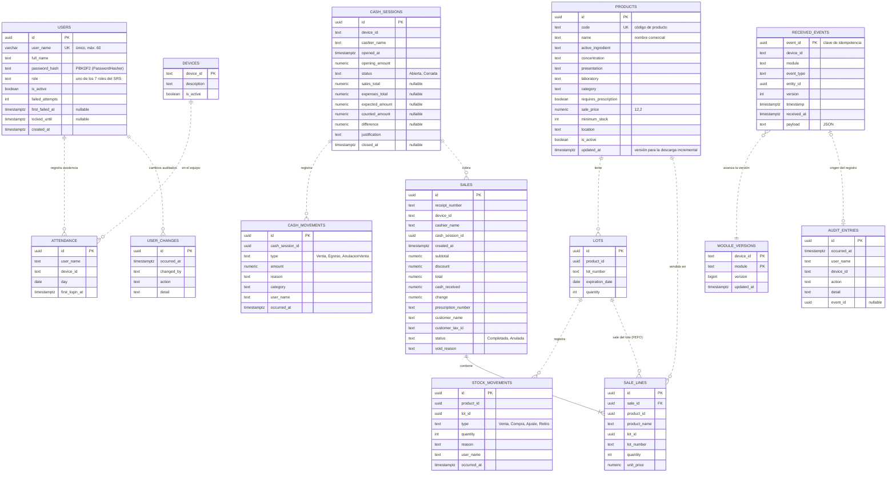

# Modelo de base de datos

Modelo entidad-relación del **Sistema de Gestión para Farmacéutica**, tal como lo
crean las migraciones EF Core del Sprint 1. Sigue el ADR-005: una sola instancia
de PostgreSQL, un *schema* por dominio y un usuario de base de datos por servicio.
Cada puesto de caja guarda además una copia local en SQLite (ADR-002).

| Código | Contenido | Fuente |
| --- | --- | --- |
| `LGS-MOD-BD-1` | Base central PostgreSQL (schemas `identity`, `inventory`, `sales`, `cash`, `audit`, `sync`) | Migraciones `Inicial` de cada servicio |
| `LGS-MOD-BD-2` | Base local SQLite del puesto | `src/frontend/Pharmacy.Desktop/Data/LocalDb.cs` |

## Migraciones

| Servicio | Schemas | Migración | Historial |
| --- | --- | --- | --- |
| Identity Service | `identity` | `src/backend/Identity.Api/Migrations/*_Inicial.cs` | `identity.__ef_migrations_history` |
| Business Service | `inventory`, `sales`, `cash`, `audit` | `src/backend/Business.Api/Migrations/*_Inicial.cs` | `inventory.__ef_migrations_history` |
| Sync Service | `sync` | `src/backend/Sync.Api/Migrations/*_Inicial.cs` | `sync.__ef_migrations_history` |

Cada servicio aplica sus migraciones pendientes al arrancar (`MigrateAsync` en
`Pharmacy.ServiceDefaults`). Para agregar una migración nueva:

```sh
dotnet tool install -g dotnet-ef --version 8.0.11
dotnet ef migrations add <Nombre> -p src/backend/Business.Api -o Migrations
```

Los servicios no comparten tablas: se comunican por API. Por eso las relaciones
entre schemas (por ejemplo, `sales.sale_lines.product_id` → `inventory.products`)
son **referencias lógicas** sin clave foránea, y en el diagrama se dibujan con
línea punteada. La única clave foránea física es `sale_lines.sale_id` → `sales.id`.

## Base central (PostgreSQL)



| Schema | Tablas | Requisitos principales |
| --- | --- | --- |
| `identity` | `users`, `devices`, `attendance`, `user_changes` | RF-001 a RF-008, RF-075, RNF-004 |
| `inventory` | `products`, `lots`, `stock_movements` | RF-009 a RF-025, RF-095, RF-109 |
| `sales` | `sales`, `sale_lines` | RF-037 a RF-048, RF-091, RF-096 |
| `cash` | `sessions`, `movements` | RF-052 a RF-062, RF-106 |
| `audit` | `entries` | RF-075 |
| `sync` | `received_events`, `module_versions` | RF-080, RF-081, RF-102, RF-104 |

## Base local del puesto (SQLite)

La copia local permite vender sin conexión. Repite las tablas de inventario,
ventas y caja con prefijo de dominio y agrega la cola de salida (*Outbox*).

| Tabla | Contenido |
| --- | --- |
| `inventory_products`, `inventory_lots`, `inventory_movements` | Catálogo descargado del servidor y stock local por lote |
| `sales_sales`, `sales_lines` | Ventas del puesto |
| `cash_sessions`, `cash_movements` | Caja del turno |
| `sync_outbox` | Eventos pendientes de enviar al Sync Service (clave `event_id`) |
| `sync_state` | Versión del catálogo ya descargada |
| `identity_cached_users` | Credenciales en caché para iniciar sesión sin conexión |
